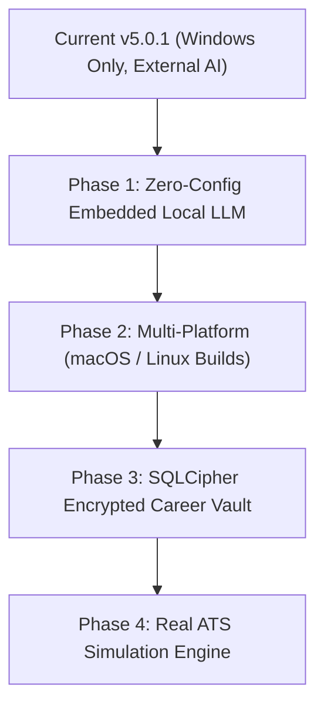

# 🔍 Kairo Application Comprehensive Audit Report & Usability Analysis

**Application:** Kairo (v5.0.1)  
**Architecture:** Tauri v2 · Rust Backend · SQLite (WAL mode) · React 18 · TypeScript · Tailwind CSS v4 · Tectonic Typesetting Sidecar  
**Scope:** Full-codebase scan (Frontend, Backend, Database, IPC API, Build & Infrastructure, UI/UX, Security, Real-World User Journey)  
**Date:** November 2026  

---

## 🛑 Executive Summary: The Real-Life Usability Breakdown

Automated test suites (186/186 Rust tests and 52/52 Vitest unit tests) passing with 0 failures can create a false impression of health. When an actual user opens Kairo with a real resume and a real job posting, **the core user experience breaks down almost immediately**.

### The 6 Core Deal-Breakers in Daily Usage

1. **Resume Bullets are 100% Read-Only in Resume Studio (`/jobs/:id/resume`):**
   - The primary editor screen has no input field, no textarea, and no inline editing mechanism for resume bullets.
   - The only interactive controls are `Eye` (hide/show) and up/down reorder buttons.
   - To fix a single typo or reword a bullet for a specific job, the user must:
     1. Close Resume Studio.
     2. Open the sidebar and click **Story** (`/story`).
     3. Search/scroll through records to find the specific experience or project.
     4. Open the Record Inspector modal.
     5. Click the *"Resume points"* tab.
     6. Click the pencil icon on the bullet.
     7. Edit the text and save.
     8. Close the modal.
     9. Navigate to **Jobs** (`/jobs`).
     10. Open the specific job workspace.
     11. Re-open Resume Studio.
     12. Click *"Sync from Vault"*.
     13. Re-export the PDF.
   - *Impact:* A resume builder that forces a 13-step round trip to edit a single sentence feels unusable.

2. **Education is Completely Missing from the Resume Studio Left Panel:**
   - In `ResumeStudioPage.tsx`, `contentSections` only iterates `experience` and `projects`.
   - The left curation sidebar provides zero controls for Education. Users cannot exclude a degree, reorder multiple universities, or modify educational details inside Resume Studio.

3. **Hardcoded Section Ordering in the Default Template:**
   - In `latex.rs`, section ordering for the default ATS-compliant Jake template is hardcoded:
     $$\text{Heading} \longrightarrow \mathbf{\text{Education}} \longrightarrow \mathbf{\text{Experience}} \longrightarrow \text{Projects} \longrightarrow \text{Achievements} \longrightarrow \text{Skills}$$
   - Any professional with 5–15+ years of experience expects Work Experience above Education. In Kairo, high school or college from a decade ago is permanently locked above current senior roles with no UI or config option to change it.

4. **Resume Importer Silently Discards All Certifications:**
   - In `src-tauri/src/imports.rs:222`, `"certifications" | "certificates" | "certifications & training"` are mapped to `Some(Section::Ignored)`.
   - When an engineer uploads a resume, all AWS, GCP, CKA, PMP, and security certifications are silently thrown away, even though the database schema and Vault UI support certifications.

5. **Windows Explorer "Reveal in Folder" Syntax Error:**
   - In `src-tauri/src/commands/pdf_commands.rs:338`, `Command::new("explorer").arg("/select,").arg(path).spawn()` passes two separate argv parameters.
   - On Windows, `explorer.exe /select, "path"` fails to highlight the compiled PDF and opens the default `Documents` folder instead.

6. **AI Batch Tailoring Crashes on Worker Abort:**
   - In `src-tauri/src/commands/ai_commands.rs:457`, `.map(|h| h.join().expect("tailor worker"))` panics the Tauri command thread if an AI worker thread experiences a network timeout or termination, causing an unhandled crash dialog instead of an inline error toast.

---

## 🛠️ Category 1: Bug Fixes & Code Quality Issues

### 🔴 High Priority (Core Workflow Blockers)

| ID | Location | Finding | Real-World Impact | Resolution |
|---|---|---|---|---|
| **FIX-01** | `src/features/resume-studio/ResumeStudioPage.tsx:1094-1135` | Bullets rendered as static `` elements without editing capabilities. | User cannot modify resume text in the editor. | Add inline `<textarea>` or popover editing with a direct call to `mutatePlan`. Add an *"Add Bullet"* action below each item. |
| **FIX-02** | `src/features/resume-studio/ResumeStudioPage.tsx:864` | `contentSections` omits `plan.education`. | Education cannot be curated, excluded, or reordered in Resume Studio. | Add an Education curation card with `CirclePlus`/`CircleMinus` exclude toggles and `ChevronUp`/`ChevronDown` reorder controls. |
| **FIX-03** | `src-tauri/src/latex.rs:268-450` | Section ordering in `render_jake` is hardcoded. | Experienced professionals cannot place Experience above Education. | Add `section_order: Vec<String>` to `ResumePlan.config` and render sections dynamically according to user preference. |
| **FIX-04** | `src-tauri/src/imports.rs:222-237` | Certifications section mapped to `Section::Ignored`. | All professional certifications are dropped when importing an existing resume. | Map certifications to `Section::Certifications`, extract records into `CertificationDraft`, and update `types.ts` (`ResumeImport` and `ImportBatch`). |
| **FIX-05** | `src-tauri/src/commands/pdf_commands.rs:338` | `Command::new("explorer").arg("/select,").arg(path)` separates the argument incorrectly. | "Reveal in folder" fails to select the file on Windows and opens the wrong folder. | Combine into a single argument: `.arg(format!("/select,{}", path.display()))`. |
| **FIX-06** | `src-tauri/src/commands/ai_commands.rs:457` | `h.join().expect("tailor worker")` unwinds and panics on worker thread abort. | AI batch tailoring thread failure panics the Tauri app. | Map thread errors safely: `h.join().map_err(|_| "AI worker thread encountered a fatal error".to_string())?`. |
| **FIX-07** | `src/app/App.tsx:113-116` | Missing catch-all `<Route path="*" ... />` in router. | Hitting an invalid or stale URL renders a blank white screen with no error feedback. | Add `<Route path="*" element={<Navigate to="/" replace />} />`. |

---

### 🟡 Medium Priority (Friction & Code Quality)

| ID | Location | Finding | Real-World Impact | Resolution |
|---|---|---|---|---|
| **FIX-08** | `src/components/Splash.tsx:30` `src/features/settings/SettingsPage.tsx:118` | Relative image asset path (`"brand/..."`). | Images fail with 404 on nested routes like `/jobs/:id/resume`. | Use absolute paths: `"/brand/lockup-horizontal-dark-400.png"`. |
| **FIX-09** | `src/features/jobs/ResumeTab.tsx` | 234 lines of dead, unused code left in repository. | Confuses maintainers and triggers ESLint hook warnings. | Remove the orphaned file. |
| **FIX-10** | `src/components/CommandPalette.tsx:40` | Palette links to deprecated `/interview` route; `/skills` is missing. | Navigation command fails; key skills screen cannot be opened via palette. | Remove `/interview`, add `{ to: "/skills", label: "Skills", icon: Sparkles }`. |
| **FIX-11** | 13 UI Components (e.g. `TrashDialog.tsx`, `RecordInspector.tsx`) | Synchronous `setState` inside `useEffect([open])` triggers 22 ESLint warnings. | Causes cascading re-renders in React 18+. | Use `key={open ? 'open' : 'closed'}` to reset component state on mount. |
| **FIX-12** | `src-tauri/tauri.conf.json:28` | Static window dimensions (1280x800) with no state persistence. | Window size, position, and maximized state reset on every launch. | Integrate `@tauri-apps/plugin-window-state`. |

---

### 🟢 Low Priority (Cosmetic & Polish)

| ID | Location | Finding | Real-World Impact | Resolution |
|---|---|---|---|---|
| **FIX-13** | `src/features/dashboard/DashboardPage.tsx:87` | Link targets `/vault` which performs an unnecessary client redirect. | Minor routing round trip. | Update target directly to `/story`. |
| **FIX-14** | `website/index.html:79` | Fallback hero banner displays hardcoded `v5.0.0`. | Shows outdated version if GitHub release check fails. | Update fallback string to `v5.0.1`. |
| **FIX-15** | `src/components/ui/TrashDialog.tsx:35` | Unused `// eslint-disable-next-line` directive. | Linter noise. | Remove unused directive. |

---

## 🔒 Category 2: Security Fixes

| Priority | ID | Location | Vulnerability / Finding | Impact | Recommended Fix |
|---|---|---|---|---|---|
| **High** | **SEC-01** | `src-tauri/tauri.conf.json:44` | CSP lacks explicit `worker-src` and `connect-src` directives. | In hardened WebView2 environments, PDF.js web workers (`pdf.worker.min.mjs` and blob workers) can be blocked, preventing PDF rendering. | Add `worker-src 'self' blob:; connect-src 'self' http://localhost:* http://127.0.0.1:* https://api.openai.com;` to the CSP configuration. |
| **High** | **SEC-02** | `src-tauri/src/latex.rs:105-120` (`latex_href`) | URI schemes in resume links are not whitelisted. | Malicious or manipulated profile URLs (e.g. `file:///`, `ms-msdt:`, `run:`) could execute arbitrary local commands when clicked in desktop PDF readers. | Restrict protocols: only allow `http://`, `https://`, and `mailto:` links. |
| **Medium** | **SEC-03** | `src-tauri/src/commands/pdf_commands.rs:356` | `sanitize_download_name` checks path separators but omits Windows reserved DOS device names. | Saving a PDF as `CON.pdf`, `PRN.pdf`, `AUX.pdf`, or `NUL.pdf` causes Windows filesystem errors or hangs. | Reject or prefix Windows reserved device names (`CON`, `PRN`, `AUX`, `NUL`, `COM1-9`, `LPT1-9`). |
| **Medium** | **SEC-04** | `src-tauri/src/ai.rs:32` | Keyring user account is hardcoded to `"ai-api-key"`. | Multiple app profiles on the same OS user account share the exact same API credentials. | Namespace the keyring user key with a hash of the app data directory or profile name. |
| **Low** | **SEC-05** | `src-tauri/src/imports.rs:1842` | `github_repo_candidate` makes unauthenticated GET requests to the GitHub API. | Hits GitHub's unauthenticated 60 req/hr rate limit and exposes user IP address. | Add user feedback for HTTP 403 rate limits and provide manual input fallback. |
| **Low** | **SEC-06** | Local AppData SQLite Database | Career history, contact details, and notes stored in unencrypted SQLite on disk. | Physical device access allows reading private career history. | Document storage paths; consider optional SQLCipher encryption at rest. |

---

## 📋 Category 3: Features Left to Add (Incomplete Core Workflows)

### 🔴 High Priority

1. **Direct Custom Bullet & Record Creation in Resume Studio:**
   - *Problem:* Users cannot add a quick one-off bullet or temporary project directly while tailoring for a specific job.
   - *Requirement:* Add an *"Add Bullet"* action under any record in Resume Studio, and an *"Add Custom Item"* action to include role-specific achievements without modifying the master Vault.

2. **Multi-Format Export (DOCX & Plain Text / Markdown):**
   - *Problem:* Large corporate ATS portals (Workday, Taleo, iCIMS) frequently reject multi-column PDFs or explicitly require `.docx` files.
   - *Requirement:* Use Rust's `docx-rs` crate to export the structured `ResumePlan` directly to an ATS-safe Microsoft Word `.docx` file.

3. **Multiple Resume Variants per Job Workspace:**
   - *Problem:* Users often want to maintain two angles for the same role (e.g., *"Full-Stack Focus"* vs. *"Platform/DevOps Focus"*) to compare match scores.
   - *Requirement:* Support multiple `ResumePlan` instances under a single `job_id`.

---

### 🟡 Medium Priority

4. **Grounded Cover Letter Studio:**
   - *Problem:* Applicants need cover letters matching the specific requirements of the role.
   - *Requirement:* Add a *"Cover Letter"* tab in Job Workspace that uses job requirements and verified evidence to generate and typeset a matching cover letter in Jake/Expressive styles.

5. **LinkedIn Data Archive (.zip) Import:**
   - *Problem:* Extracting career history from unstructured resume PDFs is lossy.
   - *Requirement:* Add support in `extractFile.ts` to parse official LinkedIn data exports (`Profile.csv`, `Positions.csv`, `Skills.csv`).

6. **Dark Reading Mode for PDF Preview:**
   - *Problem:* In Midnight Dark Theme (`#0B1020`), the PDF canvas is a stark white rectangle that causes eye strain.
   - *Requirement:* Add a dark reading mode toggle in `PdfViewer.tsx` using CSS filters (`filter: invert(0.88) hue-rotate(180deg)`).

---

### 🟢 Low Priority

7. **Applications Pipeline Kanban Board:**
   - *Problem:* Applications are currently listed as flat cards with status pills.
   - *Requirement:* Add an interactive drag-and-drop Kanban board view (`Wishlist` $\rightarrow$ `Applied` $\rightarrow$ `Interview` $\rightarrow$ `Offer` $\rightarrow$ `Closed`).

8. **Interview Prep Voice Practice:**
   - *Problem:* Users prepare for interview questions by reading text only.
   - *Requirement:* Allow recording audio answers to generated interview questions directly inside the app.

---

## 🚀 Category 4: Strategic Roadmap (10x Future Enhancements)

### 🔴 High Priority

1. **Embedded Local LLM (Zero-Setup Offline AI):**
   - *Goal:* Remove the requirement for users to purchase OpenAI API credits or install external software like Ollama.
   - *Architecture:* Bundle a quantized 1.5B/3B lightweight model (such as Qwen-2.5-Coder-1.5B-Instruct) using `llama-cpp-rs`.
   - *Impact:* Out-of-the-box, 100% private, zero-configuration AI resume tailoring on first launch.

2. **Cross-Platform macOS and Linux Releases:**
   - *Goal:* Broaden availability to the entire developer community.
   - *Architecture:* The Rust backend and React frontend are already platform-agnostic. Setup GitHub Actions CI matrix builds for `.dmg` (Apple Silicon & Intel) and `.deb`/`.AppImage` (Linux).

---

### 🟡 Medium Priority

3. **Encrypted Career Vault at Rest (SQLCipher):**
   - *Goal:* Protect sensitive career and compensation data against device theft or shared computer inspection.
   - *Architecture:* Enable the `"bundled-sqlcipher"` feature on `rusqlite` with user-managed master key derivation.

---

### 🟢 Low Priority

4. **Real ATS Parser Simulation Engine:**
   - *Goal:* Eliminate guesswork about how automated HR screening systems view the exported resume.
   - *Architecture:* Run an open-source ATS parser (like `Apache Tika` or `pdfplumber`) locally in reverse to display the exact tokenized text, sections, and keywords extracted from the generated PDF.

---

## 📊 Detailed Component-by-Component Audit

| Module / Page | Primary Files | Status | Critical Findings & Usability Friction |
|---|---|---|---|
| **Onboarding** | `OnboardingPage.tsx`, `extractFile.ts` | 🟡 Needs Work | Discards certifications during import; parser occasionally misinterprets mixed phone/social links. |
| **Dashboard** | `DashboardPage.tsx` | 🟢 Stable | Routes `/vault` to `/story` via redirect; lacks quick-jump to most recent active resume draft. |
| **Vault / Story** | `VaultPage.tsx`, `RecordInspector.tsx` | 🟡 Complex | High friction: editing a bullet requires 6 modal clicks because Resume Studio lacks inline editing. |
| **Skills Library** | `SkillsTab.tsx`, `SkillsPage.tsx` | 🟢 Good | Alias management functions properly; missing bulk category re-assignment and command palette link. |
| **Jobs Directory** | `JobsPage.tsx` | 🟢 Stable | Workspaces create and delete cleanly; JD parser extracts skills and responsibilities accurately. |
| **Job Workspace** | `JobWorkspacePage.tsx`, `workspaceSteps.tsx` | 🟡 Incomplete | "Resume" tab is an empty card redirecting to Resume Studio; legacy `ResumeTab.tsx` is dead code. |
| **Resume Studio** | `ResumeStudioPage.tsx` | 🔴 Broken UX | Bullets are read-only; Education omitted from left panel; section order hardcoded; 100% white PDF canvas in dark mode. |
| **PDF Viewer** | `PdfViewer.tsx` | 🟡 Needs Work | Windows Explorer reveal syntax bug; PDF.js worker requires CSP update; no dark reading mode. |
| **Applications** | `ApplicationsPage.tsx` | 🟡 Needs Work | Flat list view only; missing Kanban drag-and-drop; applications do not auto-link on PDF export. |
| **Settings** | `SettingsPage.tsx` | 🟢 Good | Keyring storage works; brand asset path broken on nested routes; missing window state persistence. |
| **LaTeX Engine** | `latex.rs`, `composer.rs` | 🟡 Rigid | Tectonic compiles reliably; section ordering is rigidly hardcoded; URL schemes lack protocol whitelist. |
| **AI Subsystem** | `ai.rs`, `ai_commands.rs`, `tailor.rs` | 🟡 Unsafe | Anti-hallucination validation is robust; worker thread `.expect()` panics Tauri if AI thread aborts. |

---

## 🎯 Immediate Recommended Action Plan

To transform Kairo into a reliable, daily-usable application, implement changes in this order:

1. **Step 1: Unblock the Core Editor (Resume Studio)**
   - Add inline bullet text editing and custom bullet creation directly in `ResumeStudioPage.tsx`.
   - Add Education curation controls to the left panel.
2. **Step 2: Fix Resume Output Structure**
   - Make section ordering configurable in `ResumePlan.config` and `latex.rs`.
   - Fix the Windows Explorer file reveal command syntax.
3. **Step 3: Fix Data Ingestion**
   - Update `imports.rs` to stop ignoring Certifications, Courses, and Publications.
4. **Step 4: Harden Security & Stability**
   - Update CSP directives in `tauri.conf.json`.
   - Replace worker thread `.expect()` with safe error handling in `ai_commands.rs`.
   - Add URI protocol whitelist to `latex.rs`.

